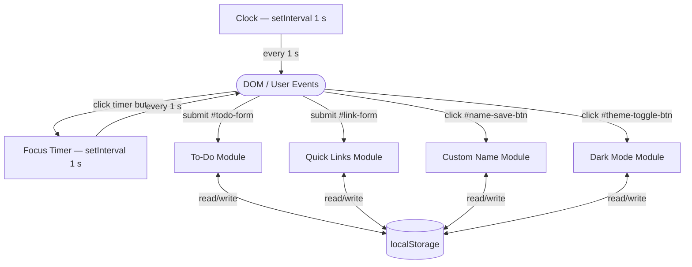

# Design Document

## Overview

The To-Do List Life Dashboard is a single-page productivity application delivered as three plain files: `index.html`, `css/style.css`, and `js/script.js`. There is no build step, no bundler, no framework, and no backend. All persistence is handled by the browser's `localStorage` API.

The page is divided into a gradient header (greeting, date/time, name form, theme toggle), a three-column CSS Grid main area (Focus Timer | To-Do List | Quick Links), and a footer. The layout collapses to two columns on tablet and one column on mobile.

---

## Architecture



### Key Design Decisions

| Decision | Rationale |
|---|---|
| Three separate files | Required project structure; separation of concerns |
| CSS custom properties for all colours | Enables dark mode with zero JS colour manipulation — just toggle `body.dark` |
| `Date.now()` as item IDs | Unique within a session; no external UUID library needed |
| `data-task-id` on every `<li>` | Allows O(1) LocalStorage lookup by ID on delete/edit without a full re-render |
| `textContent` / DOM properties only | Prevents HTML injection when rendering user-supplied text |
| `insertAdjacentElement` for errors | Keeps error messages in document flow next to the offending input |
| `try/catch` on all LS reads | Graceful degradation if storage is full or disabled |
| Inline edit (replace span with input) | No modal needed; edit stays in context |
| Timer interval guard (`timerInterval !== null`) | Prevents stacked intervals on repeated Start clicks |

---

## File Structure

```
CodingCamp-[19 Oktober 2026]-[Rasyid Al Luthfi]/
├── index.html          ← semantic HTML, all IDs, no inline styles or scripts
├── css/
│   └── style.css       ← custom properties, layout, components, dark mode, responsive
└── js/
    └── script.js       ← all logic, 10 sections, no external dependencies
```

---

## HTML Structure

```
<body>
  <header id="greeting-section">
    <p id="greeting-text">  … <span id="user-name"> … </span> …  </p>
    <p id="datetime-display"></p>
    <div id="name-form">
      <input id="name-input" />
      <button id="name-save-btn">Save</button>
    </div>
    <button id="theme-toggle-btn">🌙 Dark Mode</button>
  </header>

  <main id="dashboard">          <!-- CSS Grid: 1fr 2fr 1.5fr -->
    <section id="timer-section">
      <div id="timer-display">25:00</div>
      <div id="timer-controls">
        <button id="timer-start-btn">▶ Start</button>
        <button id="timer-stop-btn">⏸ Stop</button>
        <button id="timer-reset-btn">↺ Reset</button>
      </div>
    </section>

    <section id="todo-section">
      <form id="todo-form">
        <input id="todo-input" />
        <button id="todo-add-btn">Add</button>
      </form>
      <ul id="todo-list"></ul>        <!-- populated by JS -->
    </section>

    <section id="links-section">
      <form id="link-form">
        <input id="link-name-input" />
        <input id="link-url-input" type="url" />
        <button id="link-add-btn">Add Link</button>
      </form>
      <ul id="link-list"></ul>        <!-- populated by JS -->
    </section>
  </main>

  <footer id="site-footer">
    Built by <span id="footer-name">Rasyid Al Luthfi</span>
  </footer>
</body>
```

---

## CSS Architecture

All colours are CSS custom properties on `:root`. Dark mode overrides only those properties on `body.dark`.

```
:root {
  --clr-bg, --clr-surface, --clr-surface-alt, --clr-border
  --clr-primary, --clr-primary-hover, --clr-danger, --clr-success
  --clr-text-strong, --clr-text, --clr-text-muted
  --clr-timer-ring
  --shadow-card, --shadow-card-hover
  --space-xs/sm/md/lg/xl
  --radius-sm/md/lg
  --font-sans, --font-mono
  --transition
}

body.dark {
  /* overrides only the colour tokens above */
}
```

Responsive breakpoints:
- ≥ 901 px — three columns: `1fr 2fr 1.5fr`
- 581 px – 900 px — two columns: `1fr 1fr`, to-do spans both
- ≤ 580 px — single column, stacked header

---

## JavaScript Module Layout

`script.js` is structured in 10 numbered sections, each preceded by a comment banner:

| Section | Responsibility |
|---|---|
| 1. DOM References | `const` bindings for every element ID used |
| 2. LocalStorage Keys | Named constants for all four LS keys |
| 3. Utility Helpers | `pad()`, `normalise()`, `showError()`, `isValidUrl()` |
| 4. Greeting / Clock | `getGreetingWord()`, `formatDatetime()`, `startClock()` |
| 5. Custom Name | `loadName()`, `saveName()`, `applyName()` |
| 6. Dark Mode | `loadTheme()`, `applyTheme()`, `toggleTheme()` |
| 7. Focus Timer | Timer state, `startTimer()`, `stopTimer()`, `resetTimer()` |
| 8. To-Do List | `loadTasks()`, `saveTasks()`, `createTaskElement()`, `renderTasks()`, `addTask()` |
| 9. Quick Links | `loadLinks()`, `saveLinks()`, `createLinkElement()`, `renderLinks()`, `addLink()` |
| 10. Initialisation | `init()` — boot sequence called once on script load |

---

## Data Models

### Task

```
{
  id:        number,   // Date.now() at creation time
  text:      string,   // raw user-entered text
  completed: boolean
}
```

LocalStorage key: `dashboard_tasks`

### Quick Link

```
{
  id:   number,   // Date.now() at creation time
  name: string,   // display label
  url:  string    // validated http/https URL
}
```

LocalStorage key: `dashboard_links`

### Theme

LocalStorage key: `dashboard_theme` — value: `'light'` | `'dark'`

### Username

LocalStorage key: `dashboard_username` — value: any non-empty string

---

## Focus Timer State Machine

```
         [IDLE / STOPPED]
              │
        click Start
              │
              ▼
          [RUNNING] ──── click Stop ──── [PAUSED]
              │                              │
         reaches 00:00               click Start
              │                              │
              ▼                              ▼
         [COMPLETE]                     [RUNNING]
              │
         click Reset (from any state)
              │
              ▼
         [IDLE / STOPPED]  →  display resets to 25:00
```

Guard: `timerInterval !== null` check prevents stacking intervals.

---

## Task Inline Edit Flow

```
Normal state:
  <li data-task-id="…">
    <input type="checkbox">
    <span class="task-text">Buy milk</span>
    <button class="btn-edit">Edit</button>
    <button class="btn-delete">Delete</button>
  </li>

Edit mode (after clicking Edit):
  <li data-task-id="…">
    <input type="checkbox">
    <input class="edit-input" value="Buy milk">   ← span replaced
    <button class="btn-edit">Save</button>         ← label swapped
    <button class="btn-delete">Delete</button>
  </li>
```

Confirm: Enter key or Save button click → validate → persist → restore span.
Cancel: Escape key or blur (150 ms delay) → discard → restore span.

---

## Error Handling

| Scenario | Behaviour |
|---|---|
| Empty task input | `showError(todoInput, 'Please enter a task.', 'todo-add-error')` |
| Duplicate task on add | `showError(todoInput, 'That task already exists.', 'todo-add-error')` |
| Empty task on edit | `showError(editInput, 'Task cannot be empty.', 'edit-task-error')` |
| Duplicate task on edit | `showError(editInput, 'A task with that name already exists.', 'edit-task-error')` |
| Empty link name | `showError(linkNameInput, 'Please enter a site name.', 'link-name-error')` |
| Empty link URL | `showError(linkUrlInput, 'Please enter a URL.', 'link-url-error')` |
| Invalid URL protocol | `showError(linkUrlInput, 'Enter a valid URL starting with https://', 'link-url-error')` |
| Empty name input | `showError(nameInput, 'Please enter a name.', 'name-error')` |
| `localStorage` parse error | `try/catch` → return `[]` or default; no console error surfaced |

All `showError` calls use a stable `id` so re-triggering the same error replaces the old message instead of stacking a second one. Messages auto-remove after 3 000 ms.
